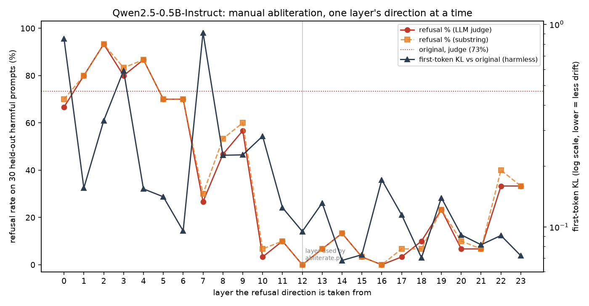

# LLM Abliteration Lab

A small, hands-on lab for **abliteration** (refusal-direction ablation) on a
tiny instruct model, plus a comparison with [Heretic](https://github.com/p-e-w/heretic)
(both the Abliteration modifier and the 2.x default, **ARA**).

The method comes from [Arditi et al., 2024, *Refusal in LLMs is mediated by a
single direction*](https://arxiv.org/abs/2406.11717): in many chat models the
habit of refusing a request is concentrated in one direction in the residual
stream. Removing that direction from the weights drops the refusal rate
without finetuning.

This repo is an educational notebook-in-script, run on CPU with
`Qwen/Qwen2.5-0.5B-Instruct`. It is **not** a guide for using the resulting
model on harmful requests. The point is to understand the geometry of refusal.

## What's in the box

| Path | Role |
|------|------|
| `abliterate.py` | Manual abliteration: collect activations, pick a layer, orthogonalize weights |
| `results.json` | Refusal rates and short harmless examples from the manual run |
| `refusal_direction.pt` | Unit refusal vector from the chosen layer (layer 12) |
| `compare_models.py` | Held-out comparison of original vs manual vs Heretic Abliteration vs ARA |
| `INSIGHTS.md` | Lessons learned and the three-way (plus original) comparison |
| `heretic/` | Config and runner for the Heretic 2.1 **Abliteration** run |
| `heretic/ara/` | Config and runner for the Heretic 2.1 **ARA** run |
| `eval/` | Phase 1: held-out eval (93 harmful, 100 harmless, 100 borderline) with a calibrated LLM judge |
| `quality/` | Phase 2: MMLU (200) and GSM8K (48) capability check |
| `sweep/` | Phase 3: manual abliteration repeated for every layer, with a plot |
| `model-abliterated/`, `model-heretic/`, `model-ara/` | Local weight dumps (**not** committed) |

## Manual abliteration

```bash
python -m venv .venv
source .venv/bin/activate
# On CPU:
pip install torch --index-url https://download.pytorch.org/whl/cpu
pip install -r requirements.txt

python abliterate.py
```

The script:

1. Loads `Qwen/Qwen2.5-0.5B-Instruct` in bfloat16.
2. Collects residual-stream activations at the last prompt token for
   refusal-style prompts and similarly-shaped harmless prompts.
3. Computes a candidate refusal direction per layer (difference of means).
4. Picks the best layer by testing inference-time ablation with hooks.
5. Orthogonalizes `embedding`, attention `o_proj`, and MLP `down_proj`,
   and saves the result to `model-abliterated/`.
6. Compares refusal rate and a few harmless answers.

On this lab machine (8-core CPU, 16 GB RAM, no GPU) the first run finished
in about **2.4 minutes**. Held-out refusal rate went from **67% (8/12)** to
**0% (0/12)** after editing layer 12's direction into the weights. See
`INSIGHTS.md` for caveats (the 67% is a floor, late-layer norms, tied
embeddings, and a false refusal that was also removed).

## Heretic

```bash
pip install -r heretic/requirements.txt
# If import fails with torchvision/nms errors on a CPU torch wheel:
pip uninstall -y torchvision

# Directional ablation (comparable to the manual script)
./heretic/run_heretic.sh

# Default Heretic 2.x modifier: Arbitrary-Rank Ablation
./heretic/ara/run_ara.sh
```

`heretic/config.toml` uses the **Abliteration** modifier. `heretic/ara/config.toml`
uses **ARA**, Heretic 2.x's default. Both runs use a reduced CPU-sized budget
(12 trials, shortened prompt slices). Output models go to `model-heretic/` and
`model-ara/` and are not committed.

Then compare the original, the manual edit, Heretic Abliteration, and Heretic
ARA on the same held-out prompts:

```bash
python compare_models.py
```

The first four-way check used only 12 held-out prompts (all three edits:
0/12). The larger evaluation below supersedes it.

## Results (larger held-out evaluation)

```bash
cd eval && python run_eval.py        # refusals, over-refusal, KL
cd ../quality && python run_quality.py   # MMLU + GSM8K
cd ../sweep && python run_sweep.py   # per-layer sweep + plot
```

| Model | Harmful refused (substring / judge, n=93) | Borderline refused (judge, n=100) | First-token KL | Full-response KL | MMLU (200) | GSM8K (48) |
|-------|------------------:|------:|------:|------:|------:|------:|
| original | 70% / 68% | 20% | 0 | 0 | 42.5% | 41.7% |
| manual (layer 12) | 3% / 4% | 3% | **0.075** | 0.040 | 43.5% | 35.4% |
| Heretic Abliteration | 1% / 2% | 2% | 0.100 | **0.016** | 42.5% | 31.2% |
| Heretic ARA | **0% / 0%** | 4% | 0.101 | 0.032 | 44.0% | 31.2% |

* The judge is `Qwen2.5-3B-Instruct` on a message-only prompt. It agrees
  with the substring detector on 98–100% of harmful replies. A first judge
  that also saw the request was badly miscalibrated and was dropped (see
  `eval/README.md`).
* KL is on 100 held-out harmless prompts. Which edit "drifts least" depends
  on the metric: manual wins on first-token KL, Heretic Abliteration on
  full-response KL.
* All MMLU and refusal differences between the three edits are within noise.
  GSM8K dips 3–5 items for every edit, which is a hint rather than a result
  at n=48.



The sweep shows a wide band of usable layers (10–21: 0–13% refusals) and
that the late layers with the largest difference-of-means norm (22–23)
remove only about half the refusals. Details are in `INSIGHTS.md`.

## Hardware notes

The demo is sized for a CPU box with about 16 GB of RAM. A 0.5B model in
bfloat16 uses roughly 1 GB of weights. Do not point this script at a 7B+
model on the same machine without a GPU and more memory.
