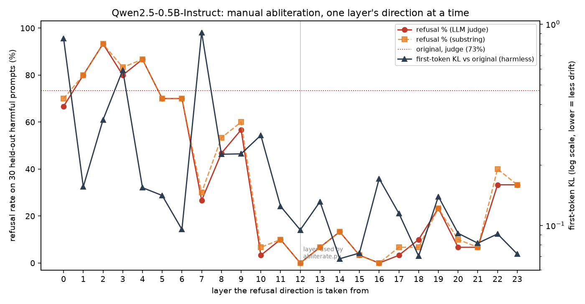

# Phase 3: layer sweep for manual abliteration

`run_sweep.py` repeats the manual edit from `abliterate.py` once per layer:
take the refusal direction from layer *l* (difference of means over the same
40 + 40 training prompts), orthogonalize the embedding, every `o_proj` and
every `down_proj` against it, then measure:

* refusal rate on 30 held-out harmful prompts (evenly spaced through
  `eval/prompts.json`, greedy, 64 new tokens), with the substring detector
  and the Qwen2.5-3B message-only judge;
* first-token KL vs the original on the 100 held-out harmless prompts.

```bash
cd sweep && python run_sweep.py    # ~20 min on the shared 8-core CPU box
```

Sanity check: the layer-12 direction recomputed here has cosine 0.9992 with
`refusal_direction.pt`.



| Layer | Refusal (judge) | First-token KL |
|------:|----------------:|---------------:|
| original | 73% | 0 |
| 0–6 | 67–93% | 0.10–0.85 |
| 7 | 27% | 0.91 |
| 8–9 | 47–57% | 0.23 |
| 10 | 3% | 0.28 |
| 11 | 10% | 0.12 |
| **12** | **0%** | 0.095 |
| 13 | 7% | 0.13 |
| 14 | 13% | **0.068** |
| 15 | 3% | 0.073 |
| 16 | 0% | 0.171 |
| 17–18 | 3–10% | 0.07–0.11 |
| 19 | 23% | 0.139 |
| 20–21 | 7% | 0.08–0.09 |
| 22–23 | 33% | 0.07–0.09 |

Full rows are in `results.json`.

## Reading it

* **Early layers (0–9) do not hold the refusal direction yet.** Removing
  their direction barely changes refusals but can still hurt a lot (layer 7:
  KL 0.91). The mean-difference norm there is tiny (0.03–0.5), so the
  "direction" is mostly noise.
* **There is a wide good band, layers 10–21.** Almost any layer there takes
  refusals to 0–13%. Layer 12, picked by `abliterate.py`, is in the band, but
  15 (3%, KL 0.073) and 18 are about as good. With 30 prompts, a 1-prompt
  difference is 3.3 points, so the band is flat within noise.
* **The last two layers (22–23) only half work.** Their difference-of-means
  vector is the largest (norm 18–20), but it mostly encodes the next-token
  decision, not the general "refuse" feature. Largest norm is not the best
  layer.
* KL is not monotonic in depth. Each layer's direction has its own side
  effects, so a sweep beats a rule of thumb.
